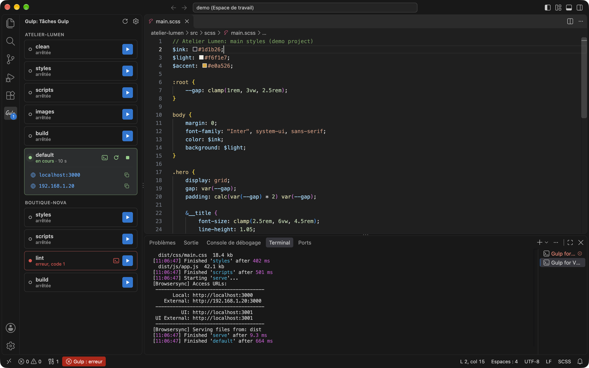

# Gulp for VS Code

[](https://marketplace.visualstudio.com/items?itemName=digital-cover.gulp-for-vscode)
[](https://marketplace.visualstudio.com/items?itemName=digital-cover.gulp-for-vscode)
[](LICENSE)

🇫🇷 [Version française plus bas](#francais)

Your project's Gulp tasks in a dedicated view: start them, stop them, restart them, and see at a glance which ones are running, which ones failed and which address BrowserSync is serving the site on.


*Screenshot taken on the [demo projects](demo/): `default` is running with BrowserSync, `lint` failed.*

## Features

- **One card per task**: the **Gulp** view in the activity bar lists the tasks found by `gulp --tasks-simple`, grouped by folder in a multi-root workspace.
- **Start, stop, restart**: ▶ starts the task, then ■ stops it and ⟳ restarts it while it is running.
- **Clear status**:
  - *stopped*;
  - *running*, with the elapsed time;
  - *error, code N* when the task exited with a failure;
  - *compilation error* when a watch is still active but a build failed (Sass, esbuild…). The error message is shown under the task and goes away on the next successful build.
- **BrowserSync URLs**: the Local and External addresses are shown under the running task. Click to open the site in the browser, or use the button to copy the address.
- **Quiet terminal**: starting a task does not open the terminal panel. Click a task to show its console, click again to close it.
- **Status bar**: a green indicator while a task is running, red on error, with details in the tooltip.
- **Badge on the Gulp icon**: the number of failed tasks, otherwise the number of running tasks.
- **Automatic detection**: the list updates when a `gulpfile` is created, changed or deleted.
- **English and French**: the interface follows VS Code's display language.

## Installation

From the Marketplace: search for **Gulp for VS Code** in the Extensions view, or run:

```bash
code --install-extension digital-cover.gulp-for-vscode
```

Or from a local package, available in [releases/](releases/):

```bash
code --install-extension releases/gulp-for-vscode-0.4.0.vsix
```

## Usage

| Action | Result |
| --- | --- |
| Click ▶ | Starts the task |
| Double-click a stopped task | Starts the task |
| Click a task | Shows its terminal, a second click closes it |
| Enter on a focused task | Starts the task, or shows its terminal if it is running |
| Click a BrowserSync URL | Opens the site in the browser |
| Click the status bar indicator | Shows the Gulp view, or the terminal (see Settings) |

The buttons at the top of the view refresh the task list and set the status bar action.

## Settings

| Setting | Values | Default |
| --- | --- | --- |
| `gulpRunner.statusBarClickAction` | `view`: shows the Gulp view<br>`terminal`: shows or hides the terminal of the running task | `view` |

## Commands

| Command | Description |
| --- | --- |
| `Gulp: Refresh Tasks` | Runs task detection again |
| `Gulp: Status Bar Click Action` | Chooses what clicking the indicator does |

## Requirements

- A `gulpfile.js`, `.mjs`, `.cjs` or `.ts` at the root of the open folder (or of each folder in a multi-root workspace).
- Gulp installed in the project (`node_modules/.bin/gulp`) or available through `npx`.

Tasks run in a login shell, so they inherit the terminal's `PATH` (nvm, Homebrew…).

## Limitations

- One gulpfile per workspace folder, at its root.
- Compilation errors are detected by reading Gulp's output (`Error:`, `[ERROR]`, `errored after`). They show up in the view and the status bar, not in the Problems tab.

## Development

```text
src/
  extension.js   activation, commands, gulpfile detection
  detect.js      task list (gulp --tasks-simple)
  runner.js      starting and tracking tasks (VS Code Tasks API)
  pty.js         task terminal, error and URL parsing
  view.js        sidebar webview
  status.js      status bar indicator
media/           icons, CSS and JS for the view
l10n/            French translations (package.nls.*.json for the manifest)
demo/            fictional projects for testing and screenshots
```

To try the extension without touching a real project, open the demo workspace (see [demo/README.md](demo/README.md)):

```bash
code --extensionDevelopmentPath="$PWD" demo/demo.code-workspace
```

Build the package:

```bash
npm run package   # creates releases/gulp-for-vscode-<version>.vsix
```

Changes are listed in the [CHANGELOG](CHANGELOG.md).

## License

[MIT](LICENSE) © Martin Vauchel

---

<a id="francais"></a>

# Version française

Les tâches Gulp du projet dans une vue dédiée : les lancer, les arrêter, les relancer, et voir d'un coup d'œil lesquelles tournent, lesquelles ont échoué et à quelle adresse BrowserSync sert le site.



*Capture réalisée sur les [projets de démonstration](demo/) : `default` tourne avec BrowserSync, `lint` a échoué.*

## Fonctionnalités

- **Une carte par tâche** : la vue **Gulp** de la barre d'activité liste les tâches détectées par `gulp --tasks-simple`, regroupées par dossier dans un espace de travail multi-racine.
- **Lancer, arrêter, relancer** : ▶ lance la tâche, puis ■ l'arrête et ⟳ la relance pendant qu'elle tourne.
- **Statut clair** :
  - *arrêtée* ;
  - *en cours*, avec la durée écoulée ;
  - *erreur, code N* quand la tâche s'est terminée en échec ;
  - *erreur de compilation* quand un watch reste actif mais qu'un build a échoué (Sass, esbuild…). Le message d'erreur s'affiche sous la tâche et disparaît au build réussi suivant.
- **URLs BrowserSync** : les adresses Local et External s'affichent sous la tâche en cours. Un clic ouvre le site dans le navigateur, le bouton copie l'adresse.
- **Terminal discret** : le lancement n'ouvre pas le panneau terminal. Un clic sur une tâche affiche sa console, un second clic la referme.
- **Barre d'état** : un indicateur vert quand une tâche tourne, rouge en cas d'erreur, avec le détail en infobulle.
- **Pastille sur l'icône Gulp** : le nombre de tâches en erreur, sinon le nombre de tâches en cours.
- **Détection automatique** : la liste se met à jour quand un `gulpfile` est créé, modifié ou supprimé.
- **Français et anglais** : l'interface suit la langue d'affichage de VS Code.

## Installation

Depuis le Marketplace : rechercher **Gulp for VS Code** dans la vue Extensions, ou :

```bash
code --install-extension digital-cover.gulp-for-vscode
```

Ou depuis un paquet local, fourni dans [releases/](releases/) :

```bash
code --install-extension releases/gulp-for-vscode-0.4.0.vsix
```

## Utilisation

| Action | Effet |
| --- | --- |
| Clic sur ▶ | Lance la tâche |
| Double clic sur une tâche arrêtée | Lance la tâche |
| Clic sur une tâche | Affiche son terminal, un second clic le referme |
| Entrée sur une tâche sélectionnée | Lance la tâche, ou affiche son terminal si elle tourne |
| Clic sur une URL BrowserSync | Ouvre le site dans le navigateur |
| Clic sur l'indicateur de la barre d'état | Affiche la vue Gulp, ou le terminal (voir Réglages) |

Les boutons en haut de la vue rafraîchissent la liste des tâches et règlent l'action de la barre d'état.

## Réglages

| Réglage | Valeurs | Défaut |
| --- | --- | --- |
| `gulpRunner.statusBarClickAction` | `view` : affiche la vue Gulp<br>`terminal` : affiche ou masque le terminal de la tâche en cours | `view` |

## Commandes

| Commande | Description |
| --- | --- |
| `Gulp: Rafraîchir les tâches` | Relance la détection des tâches |
| `Gulp: Action au clic sur la barre d'état` | Choisit l'action du clic sur l'indicateur |

## Prérequis

- Un `gulpfile.js`, `.mjs`, `.cjs` ou `.ts` à la racine du dossier ouvert (ou de chaque dossier d'un espace de travail multi-racine).
- Gulp installé dans le projet (`node_modules/.bin/gulp`) ou disponible via `npx`.

Les tâches sont lancées dans un shell de connexion : elles héritent du `PATH` du terminal (nvm, Homebrew…).

## Limites

- Un seul gulpfile par dossier de l'espace de travail, à sa racine.
- Les erreurs de compilation sont repérées en lisant la sortie de Gulp (`Error:`, `[ERROR]`, `errored after`). Elles apparaissent dans la vue et la barre d'état, pas dans l'onglet Problèmes.

## Développement

```text
src/
  extension.js   activation, commandes, détection des gulpfiles
  detect.js      liste des tâches (gulp --tasks-simple)
  runner.js      lancement et suivi des tâches (API Tasks de VS Code)
  pty.js         terminal des tâches, lecture des erreurs et des URLs
  view.js        vue webview de la barre latérale
  status.js      indicateur de la barre d'état
media/           icônes, CSS et JS de la vue
l10n/            traductions françaises (package.nls.*.json pour le manifeste)
demo/            projets fictifs pour les tests et les captures
```

Pour essayer l'extension sans toucher à un vrai projet, ouvrir l'espace de travail de démonstration (voir [demo/README.md](demo/README.md)) :

```bash
code --extensionDevelopmentPath="$PWD" demo/demo.code-workspace
```

Construire le paquet :

```bash
npm run package   # produit releases/gulp-for-vscode-<version>.vsix
```

Les modifications sont listées dans le [CHANGELOG](CHANGELOG.md).

## Licence

[MIT](LICENSE) © Martin Vauchel
