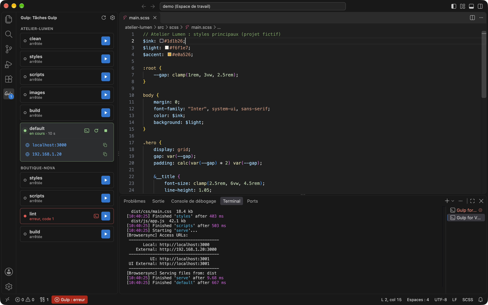

# Gulp for VS Code

[](https://marketplace.visualstudio.com/items?itemName=digital-cover.gulp-for-vscode)
[](https://marketplace.visualstudio.com/items?itemName=digital-cover.gulp-for-vscode)
[](LICENSE)

Les tâches Gulp du projet dans une vue dédiée : les lancer, les arrêter, les relancer, et voir d'un coup d'œil lesquelles tournent, lesquelles ont échoué et à quelle adresse BrowserSync sert le site.



*Capture réalisée sur les [projets de démonstration](demo/) : `default` tourne avec BrowserSync, `lint` a échoué.*

## Fonctionnalités

- **Une carte par tâche** : la vue **Gulp** de la barre d'activité liste les tâches détectées par `gulp --tasks-simple`, regroupées par dossier dans un espace de travail multi-racine.
- **Lancer, arrêter, relancer** : ▶ lance la tâche, puis ■ l'arrête et ⟳ la relance pendant qu'elle tourne.
- **Statut clair** :
  - *arrêtée* ;
  - *en cours*, avec la durée écoulée ;
  - *erreur, code N* quand la tâche s'est terminée en échec ;
  - *erreur de compilation* quand un watch reste actif mais qu'un build a échoué (Sass, esbuild…). Le message d'erreur s'affiche sous la tâche et disparaît au build réussi suivant.
- **URLs BrowserSync** : les adresses Local et External s'affichent sous la tâche en cours. Un clic ouvre le site dans le navigateur, le bouton copie l'adresse.
- **Terminal discret** : le lancement n'ouvre pas le panneau terminal. Un clic sur une tâche affiche sa console, un second clic la referme.
- **Barre d'état** : un indicateur vert quand une tâche tourne, rouge en cas d'erreur, avec le détail en infobulle.
- **Pastille sur l'icône Gulp** : le nombre de tâches en erreur, sinon le nombre de tâches en cours.
- **Détection automatique** : la liste se met à jour quand un `gulpfile` est créé, modifié ou supprimé.

## Installation

Depuis le Marketplace : rechercher **Gulp for VS Code** dans la vue Extensions, ou :

```bash
code --install-extension digital-cover.gulp-for-vscode
```

Ou depuis un paquet local, fourni dans [releases/](releases/) :

```bash
code --install-extension releases/gulp-for-vscode-0.3.5.vsix
```

## Utilisation

| Action | Effet |
| --- | --- |
| Clic sur ▶ | Lance la tâche |
| Double clic sur une tâche arrêtée | Lance la tâche |
| Clic sur une tâche | Affiche son terminal, un second clic le referme |
| Entrée sur une tâche sélectionnée | Lance la tâche, ou affiche son terminal si elle tourne |
| Clic sur une URL BrowserSync | Ouvre le site dans le navigateur |
| Clic sur l'indicateur de la barre d'état | Affiche la vue Gulp, ou le terminal (voir Réglages) |

Les boutons en haut de la vue rafraîchissent la liste des tâches et règlent l'action de la barre d'état.

## Réglages

| Réglage | Valeurs | Défaut |
| --- | --- | --- |
| `gulpRunner.statusBarClickAction` | `view` : affiche la vue Gulp<br>`terminal` : affiche ou masque le terminal de la tâche en cours | `view` |

## Commandes

| Commande | Description |
| --- | --- |
| `Gulp : rafraîchir les tâches` | Relance la détection des tâches |
| `Gulp : action au clic sur la barre d'état` | Choisit l'action du clic sur l'indicateur |

## Prérequis

- Un `gulpfile.js`, `.mjs`, `.cjs` ou `.ts` à la racine du dossier ouvert (ou de chaque dossier d'un espace de travail multi-racine).
- Gulp installé dans le projet (`node_modules/.bin/gulp`) ou disponible via `npx`.

Les tâches sont lancées dans un shell de connexion : elles héritent du `PATH` du terminal (nvm, Homebrew…).

## Limites

- Un seul gulpfile par dossier de l'espace de travail, à sa racine.
- Les erreurs de compilation sont repérées en lisant la sortie de Gulp (`Error:`, `[ERROR]`, `errored after`). Elles apparaissent dans la vue et la barre d'état, pas dans l'onglet Problèmes.

## Développement

```text
src/
  extension.js   activation, commandes, détection des gulpfiles
  detect.js      liste des tâches (gulp --tasks-simple)
  runner.js      lancement et suivi des tâches (API Tasks de VS Code)
  pty.js         terminal des tâches, lecture des erreurs et des URLs
  view.js        vue webview de la barre latérale
  status.js      indicateur de la barre d'état
media/           icônes, CSS et JS de la vue
demo/            projets fictifs pour les tests et les captures
```

Pour essayer l'extension sans toucher à un vrai projet, ouvrir l'espace de travail de démonstration (voir [demo/README.md](demo/README.md)) :

```bash
code --extensionDevelopmentPath="$PWD" demo/demo.code-workspace
```

Construire le paquet :

```bash
npm run package   # produit releases/gulp-for-vscode-<version>.vsix
```

Les modifications sont listées dans le [CHANGELOG](CHANGELOG.md).

## Licence

[MIT](LICENSE) © Martin Vauchel
